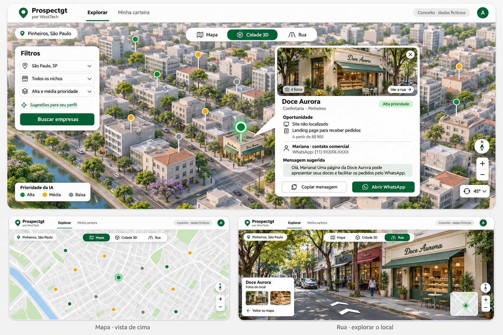

# Prospectgt — proposta de produto e arquitetura

Data: 04/11/2026. Empresa: WeztTech. Situação: proposta para validação; não é autorização de implementação.

## 1. Objetivo

Ferramenta interna de prospecção para cinco vendedores comissionados encontrarem empresas no Brasil, filtradas por ramo e região, avaliarem oportunidades e prepararem uma abordagem individual pelo WhatsApp. A oferta inicial é landing page/site de vendas, com projetos entre R$ 500 e R$ 2.000. O ERP com agenda e versões por nicho é uma oferta futura.

A meta declarada é quatro contratos por vendedor por dia, totalizando vinte contratos diários. É uma meta comercial a validar, não uma previsão nem uma capacidade prometida pelo sistema. Ainda não existe histórico de conversão nem uma quantidade acordada de empresas analisadas por dia. O piloto deve medir o fluxo real antes de dimensionar volume.

## 2. O que o usuário definiu

- Uso em celular, tablet e computador; interface limpa e funcional.
- Busca por ramo e cidade/região, com possibilidade de prospectar pelo Brasil.
- Perfil e experiência profissional sugerem nichos; não restringem o vendedor.
- Mapa visto de cima e opção de inclinar/girar, como no Maps. Não precisa reconstruir cidades em 3D com fidelidade.
- Pontos coloridos por prioridade; seleção abre informações da empresa, motivos da recomendação, oferta e mensagem personalizada.
- Fotos e exploração da rua, quando disponíveis.
- Contato comercial e contato do responsável, quando encontrados, identificando de quem é o número.
- Algoritmo de regras como base; IA apenas em funções pontuais e dispensáveis.
- Histórico automático das ações dentro do Prospectgt; feedback manual do vendedor.
- Não acompanhar mensagens ou respostas dentro do WhatsApp.
- Meta de R$ 0 de mensalidade em servidor, mapas, IA e análise. Cadastro de cartão é aceitável; isso não autoriza despesas.
- Preferência técnica por Java com Spring.

O segundo esboço foi aceito como direção visual, com a simplificação posterior do 3D. Os dados, prédios e fotos do esboço são fictícios e não constituem fonte de dados do produto.

## 3. Escopo inicial proposto

### Experiência do vendedor

1. Acessar sua conta e preencher um perfil profissional simples.
2. Escolher região e ramo, com sugestões opcionais baseadas no perfil.
3. Consultar empresas já conhecidas e solicitar uma busca quando necessário. A busca/análise pode executar em fila; não prometer resultados instantâneos nem cobertura completa.
4. Explorar pontos no mapa; alternar entre vista superior, vista inclinada e visão da rua disponível.
5. Selecionar uma empresa e consultar fatos, fontes, data da análise, sinais de oportunidade, oferta sugerida e contato disponível.
6. Preparar a abordagem, assumindo a oportunidade de forma exclusiva, e copiar a mensagem ou abrir o WhatsApp com texto preenchido.
7. Registrar feedback e, quando houver, a próxima data de contato.
8. Acompanhar as próprias oportunidades e os retornos pendentes.

Na tela pequena, filtros e detalhes não devem cobrir permanentemente o mapa; podem abrir em painel inferior. Isso é proposta de implementação, ainda sem esboço específico para celular.

### Administração — proposta do autor

Uma conta administradora convida/desativa vendedores, configura ofertas e mensagens, acompanha carteira e histórico e pode corrigir registros e reassociar oportunidades. Mudanças administrativas ficam registradas. Não haverá cadastro público irrestrito no piloto. O usuário não pediu cálculo de comissões, folha de pagamento, assinatura de contratos ou cobrança; essas funções ficam fora do escopo inicial.

### Estados e histórico

Estados iniciais propostos: disponível, em atendimento, retorno agendado, sem interesse, ganho e não contatar. O vendedor registra os resultados; não inferir uma venda a partir de um clique. “Sem interesse” encerra o atendimento e não redistribui imediatamente; reabertura somente administrativa com motivo. “Não contatar” impede novas abordagens por toda a equipe.

Registrar automaticamente: ator, empresa, ação e horário para visualização da ficha, atribuição/reserva, cópia de mensagem, clique para abrir WhatsApp, feedback, mudança de estado, expiração/liberação e intervenção administrativa. Não gravar conversas externas ou afirmar que uma mensagem foi enviada. O evento se chama “clique para abrir WhatsApp”.

## 4. Reserva aprovada

- Ao assumir uma oportunidade, a empresa fica reservada por três dias úteis.
- Sem feedback nesse prazo, volta a ficar disponível com o histórico preservado.
- Cliente interessado ou retorno combinado: reserva mantida até a data informada, mais um dia útil de tolerância.
- Venda fechada ou pedido para não receber contato: empresa sai da fila de novas abordagens.
- Visualizar a ficha ou clicar repetidamente não renova a reserva.

Detalhes propostos pelo autor para tornar a regra executável:

- Usar o fuso America/Sao_Paulo; dias úteis são segunda a sexta, sem calendário de feriados no piloto.
- Assumir uma oportunidade exige uma transação atômica. Se dois vendedores tentarem, apenas um obtém a reserva; o outro recebe a identificação do responsável e nenhuma ação comercial é executada.
- Copiar a mensagem ou abrir o WhatsApp exige reserva válida; quando a empresa estiver disponível, o próprio comando pode assumir a oportunidade, evitando um passo extra. Falha na reserva impede o comando.
- Feedback sem retorno agendado pode renovar por três dias úteis quando registra uma tentativa/avanço real. Aberturas e cópias não contam como feedback.
- Outro vendedor pode ver que a empresa está reservada, mas não pode iniciar uma abordagem pela ferramenta. A administração pode intervir com justificativa.
- Empresas repetidas devem convergir para a mesma oportunidade. Usar identificadores da fonte/CNPJ quando disponíveis e correspondência conservadora por nome, telefone e endereço. Conflitos duvidosos exigem revisão, sem unir automaticamente empresas apenas por nome semelhante.

## 5. Análise por regras e mensagem

A prioridade significa adequação para uma abordagem, não probabilidade de fechamento ou garantia de faturamento. Todo motivo exibido precisa ter evidência e data. “Site não localizado” não significa “a empresa não tem site”. Um bloqueio, tempo excedido ou falha temporária deve gerar resultado inconclusivo, não avaliação negativa definitiva.

Proposta de sinais verificáveis:

- Site encontrado, URL, disponibilidade e resultado de tentativas limitadas de acesso.
- Elementos de contato, apresentação de serviços/produtos e caminho para pedido/orçamento.
- Problemas observáveis de uso no celular, carregamento e links essenciais.
- Presença comercial identificável e contato público utilizável.
- Compatibilidade entre a necessidade identificada e uma oferta disponível da WeztTech.

Não chamar um site de “feio”, “antigo” ou “ruim” apenas por aparência, tecnologia usada ou ausência de uma palavra. Se a análise estática não permite concluir um item, mantê-lo desconhecido. Renderização de página é tarefa limitada de um worker, quando necessária, e não ocorre a cada clique no mapa.

O construtor definirá pesos e limiares iniciais simples, documentados e versionados, sem inventar calibração comercial. O aceite exige casos demonstrando os motivos: site não localizado, página funcionando com contato, falha temporária e avaliação incompleta. Dados desconhecidos não são ausência comprovada. Mostrar prioridade alta/média/baixa com texto e cor; análise pendente ou inconclusiva tem identificação distinta.

Mensagem padrão gerada por templates com nome da empresa, nome do contato somente quando confirmado, contexto observado e oferta. Sem nome do responsável, saudar a empresa. Não afirmar perda de vendas, defeito ou intenção de compra sem evidência. Valor é uma referência de oferta, não orçamento fechado. O vendedor pode revisar o texto antes de abrir o WhatsApp.

IA permanece desligada por padrão. Uma integração futura e opcional pode auxiliar na interpretação de conteúdo ou na redação. Falta de chave, cota ou disponibilidade não pode impedir busca, regras, carteira ou mensagem por template. Regras de reserva e prioridade principal nunca dependem de uma resposta de IA.

## 6. Fontes, contatos e imagens

Não construir um catálogo fictício e apresentá-lo como busca real. Cada registro precisa guardar fonte, identificador/URL e data de obtenção; correções manuais têm autoria. Endereço, coordenada, nome do responsável e telefone têm confiança/origem próprias. Não colocar um ponto exato quando só se conhece o município.

**Proposta do autor, sujeita à validação técnica do piloto:** começar com um catálogo local de estabelecimentos extraído de recortes regionais abertos do OpenStreetMap, disponíveis na Geofabrik, e complementar pelos sites públicos das próprias empresas. Uma rotina limitada de ingestão importa somente os estabelecimentos e atributos necessários, preserva a referência OSM e a data do recorte e publica a nova versão sem apagar o histórico comercial. O primeiro piloto prepara uma região pequena; uma região ainda não preparada fica explicitamente pendente, com ingestão em fila sujeita ao espaço/processamento disponíveis. Não baixar o país inteiro antecipadamente.

A busca por categoria e área ocorre no catálogo preparado, sem depender de uma chamada à Overpass pública a cada busca/movimento do mapa. A documentação da Overpass desaconselha usar instâncias públicas como backend permanente de aplicações externas; por isso, elas não são a infraestrutura primária proposta. Recortes, atualização e dimensionamento precisam ser validados no primeiro marco técnico. A taxonomia de ramos deve ser mapeada às categorias suportadas, deixando transparente quando um ramo ainda não tem fonte suficiente. Não prometer que a fonte contém todas as empresas, telefones ou proprietários. Manter a atribuição e as condições ODbL aplicáveis ao conjunto derivado.

Avaliar como complemento o `gosom/google-maps-scraper`, que já tem API e licença MIT. A licença do código não garante permissão para qualquer coleta, armazenamento ou combinação de dados de terceiros. Habilitar um conector somente depois de verificar suas condições, disponibilidade, qualidade e custo. Não depender desse coletor para afirmar que a solução inteira é open source ou gratuita. Não reescrever o motor de coleta em Java apenas para uniformizar linguagens; um conector HTTP ou importação pode reaproveitar um worker existente.

Consulta/API CNPJ pode complementar cadastro e CNAE, mas não é instalação obrigatória inicial: a base nacional local exige armazenamento e processamento relevantes. Permitir uma importação administrativa simples de dados cuja origem e uso estejam identificados, sem tornar importação manual o único caminho de prospecção.

Telefone público não é automaticamente WhatsApp. Um link WhatsApp publicado pela empresa é um sinal explícito; um número sem esse sinal permanece não confirmado. Identificar contato comercial/responsável/desconhecido. Não inventar números ou nomes, nem prometer contato pessoal do proprietário. A interface precisa funcionar quando falta contato, oferecendo outra empresa ou a consulta da fonte.

Fotos reais somente quando houver fonte que permita exibição e atribuição adequada. Não reutilizar as imagens geradas do esboço como fotos de empresas reais. Sem imagem disponível, mostrar estado sem foto. Visão da rua depende de cobertura; panorama pode não representar a fachada atual ou a posição exata.

## 7. Arquitetura proposta pelo autor

### Aplicação

- Java LTS compatível com uma versão estável de Spring Boot, Maven, Spring Security e persistência em PostgreSQL com migrações versionadas.
- Monólito modular: contas/perfis, catálogo de ofertas, empresas/fontes, pesquisa/coleta, análise, carteira/reservas, mensagens e auditoria.
- Interface renderizada com Thymeleaf, CSS e módulos JavaScript; MapLibre GL JS para o mapa. Proposta para aproveitar o domínio de Java da equipe e evitar uma SPA e uma infraestrutura separadas no piloto. Não é escolha de frontend feita pelo usuário.
- API interna/conectores para coletores. Jobs persistentes e um worker limitado inicialmente; reinício não pode perder reservas ou duplicar importações. Não exigir Redis, Kubernetes ou vários microsserviços.
- Usar cache de resultados de análise e concorrência pequena/configurável, sem reanalisar a mesma empresa por visualização.

### Mapa e rua

MapLibre oferece inclinação e rotação; qualidade e prédios dependem dos dados do mapa. Não exigir maquete fotorrealista. Tiles precisam de provedor compatível com o uso: biblioteca gratuita não equivale a hospedagem de mapas ilimitada. Atribuições permanecem visíveis; não baixar mapas de todo o país a partir de servidores públicos comunitários.

Proposta para visão da rua: avaliar Google Maps Embed, que documenta incorporação gratuita e modo Street View, com projeto/chave/faturamento habilitado. Usar modo separado, com atribuição do provedor e sem extrair/republicar panoramas. Verificar condições aplicáveis à combinação com as outras fontes antes de implementar. Se a integração não puder ser usada sem custo nas condições necessárias, apresentar a limitação e manter abertura do endereço no serviço externo; não representar essa alternativa como navegação interna concluída.

### Operação com meta de mensalidade zero

Avaliar hospedagem gratuita que comporte JVM, banco e worker; Oracle Always Free é candidata, não recurso garantido. Não basear o servidor em um plano de uso exclusivamente pessoal para operar a empresa. Registrar limites e condições do provedor escolhido durante o planejamento/validação.

Sem habilitação automática de serviços pagos, planos de cobrança por excedente ou proxies pagos. Parar/enfileirar ao atingir limites e explicar a situação ao administrador. Cadastro de cartão não é autorização de cobrança. Templates funcionam sem API de IA. Contas e chaves de serviços serão configuradas pelo usuário quando necessárias; não estão criadas ou autorizadas por este documento.

Não prometer operação ilimitada, SLA ou vinte contratos por dia. Um piloto com cinco contas deve validar fontes, cobertura de contatos, tempo de coleta/análise e uso dos recursos. O volume diário será medido, não fixado a partir da meta de contratos. Se a infraestrutura gratuita disponível não comportar a operação, a limitação precisa ser apresentada; não migrar para pago silenciosamente.

### Cuidados técnicos necessários

Autenticação e autorização no servidor; apenas o dono da reserva e a administração podem alterá-la. Não confiar só em controles visuais. Registrar ações relevantes sem expor senhas, cookies ou chaves. Ao analisar URLs externas, impedir acesso a redes/endpoints internos, limitar tamanho/tempo/redirecionamentos e tratar páginas como conteúdo não confiável. Manter backup/exportação recuperável dos dados e limitar retenção de artefatos pesados de análise.

## 8. Aceite do piloto

- Cinco vendedores conseguem usar o fluxo em celular, tablet e PC sem perda dos controles essenciais.
- Uma busca real por ramo/região traz empresas com origem/data, sem confundir demonstração com dados reais.
- A ficha diferencia fatos, sinais, dados desconhecidos e análise pendente; explica a prioridade.
- Mensagens continuam disponíveis por template sem IA; não incluem nomes, números ou problemas inventados.
- Duas tentativas simultâneas de assumir a mesma oportunidade resultam em um responsável; expiração, retorno e intervenção preservam o histórico.
- A ferramenta registra o clique de abertura, sem afirmar envio no WhatsApp; feedback pode registrar resultado e próximo retorno.
- O mapa inclina/gira quando suportado; rua e fotos têm estado explícito quando indisponíveis.
- Quotas/falhas de serviços não disparam cobranças ou integrações pagas; um componente indisponível não apaga a carteira.
- Não se considera o produto online concluído apenas porque roda localmente: acesso externo autenticado, banco persistente e limites gratuitos precisam ser verificados no ambiente escolhido.

## 9. Fora da primeira versão

ERP/SaaS futuro; marketplace público; multiempresa para vender o Prospectgt como SaaS; mensagens automáticas em massa; monitoramento de conversas no WhatsApp; inferência automática de contrato fechado; integração com pagamento/assinatura; gestão de comissões; reconstrução fiel de cidades em 3D; base nacional completa baixada antecipadamente; promessa de telefones/WhatsApp de todos os responsáveis.

## 10. O que cabe ao construtor decidir e validar

Escolher versões compatíveis, pacotes e separação dos módulos; definir pesos provisórios e limites operacionais versionados; detalhar esquema, deduplicação conservadora, jobs e endpoints; testar provedor de fontes/tiles/rua e hospedagem sem custo; escolher primeiro ramo/cidade de validação; detalhar layout responsivo e autenticação/convites. Essas são escolhas técnicas propostas, não preferências atribuídas ao usuário. Qualquer impossibilidade de manter função essencial dentro de R$ 0 deve voltar ao usuário com uma alternativa concreta.

Próximo passo após validação desta descrição: plano de implementação. Não há código de produto ou dependências instaladas nesta etapa.

## Fontes técnicas consultadas em 04/11/2026

- [Spring Boot — requisitos](https://docs.spring.io/spring-boot/system-requirements.html).
- [MapLibre GL JS](https://maplibre.org/projects/gl-js/) e [câmera](https://maplibre.org/maplibre-gl-js/docs/API/type-aliases/CameraOptions/).
- [Política de tiles vetoriais OSM](https://operations.osmfoundation.org/policies/vector/).
- [Geofabrik — recortes e licença](https://www.geofabrik.de/data/download.html), [Brasil e sub-regiões](https://download.geofabrik.de/south-america/brazil.html) e [Overpass — uso das instâncias públicas](https://dev.overpass-api.de/overpass-doc/en/preface/commons.html).
- [Google Maps Scraper](https://github.com/gosom/google-maps-scraper).
- [Consulta CNPJ](https://github.com/rictom/cnpj_consulta) e [CNPJ API](https://github.com/rictom/cnpj_api).
- [Maps Embed — uso e cobrança](https://developers.google.com/maps/documentation/embed/usage-and-billing), [configuração](https://developers.google.com/maps/documentation/embed/get-api-key), [modos](https://developers.google.com/maps/documentation/embed/embedding-map) e [termos específicos](https://cloud.google.com/maps-platform/terms/maps-service-terms).
- [WhatsApp — click to chat](https://faq.whatsapp.com/5913398998672934).
- [Oracle Always Free](https://docs.oracle.com/en-us/iaas/Content/FreeTier/freetier_topic-Always_Free_Resources.htm).
- [Gemini — opções gratuitas e pagas](https://ai.google.dev/gemini-api/docs/pricing).
